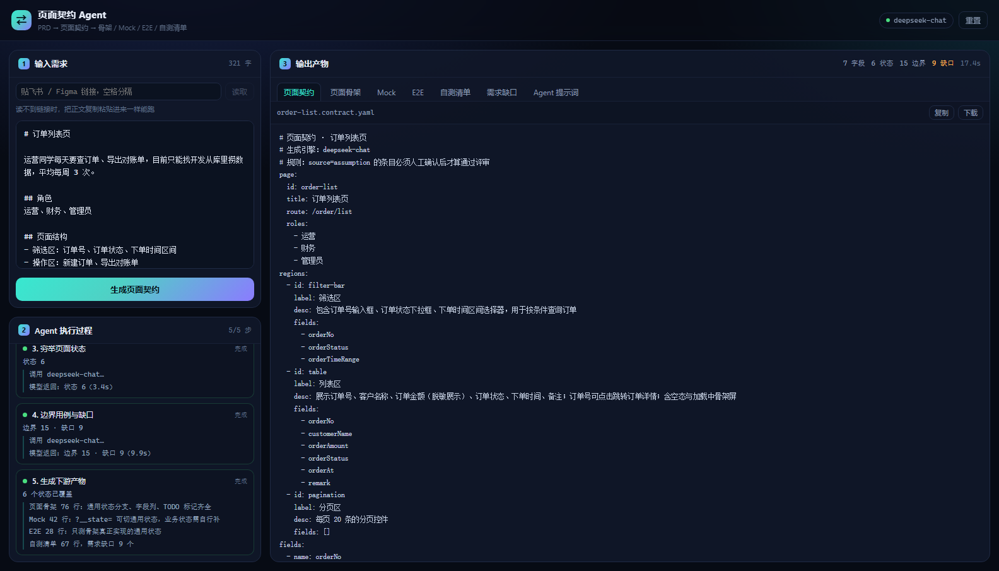
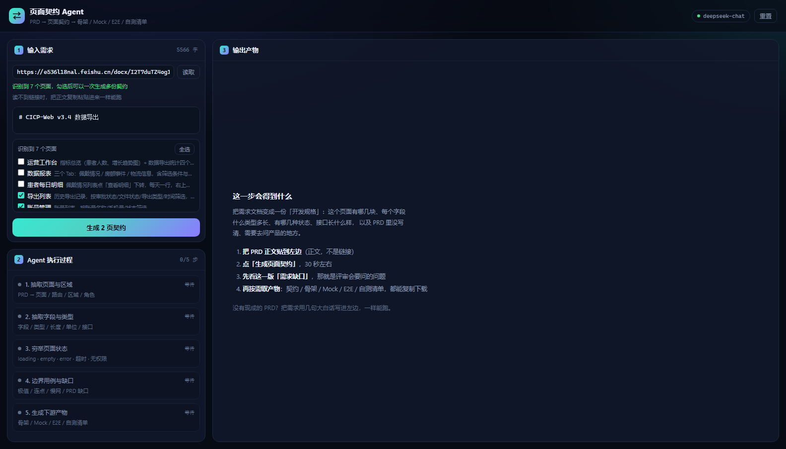
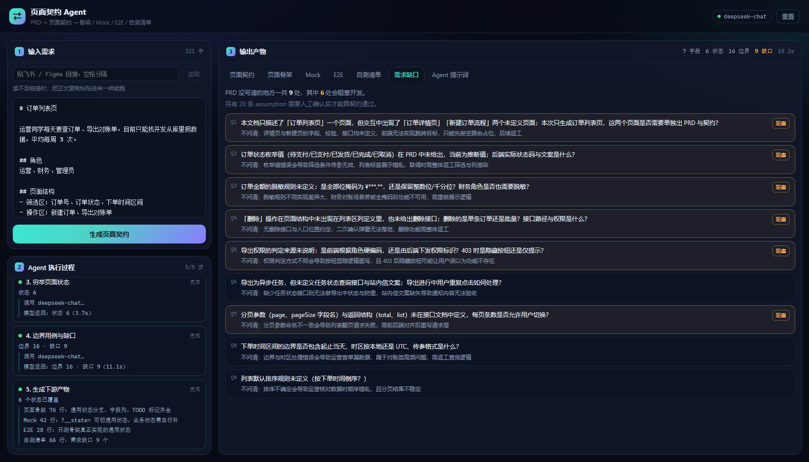
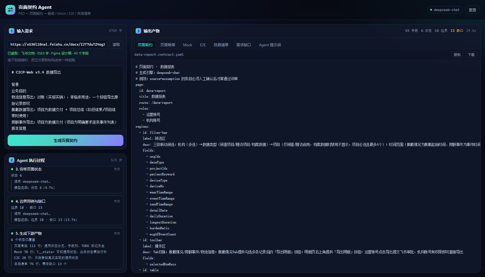

# 页面契约 Agent

> 输入一段 PRD，输出一份能拿去开评审会的「页面契约」：区域、字段、状态机、接口、边界用例、需求缺口，外加页面骨架 / Mock / E2E / 自测清单。
>
> 一句话立意：**AI 用在需求进开发之前。省的不是编码时间，是返工。**



## 它解决的不是「写代码慢」

前端真正的浪费来自「写错方向」和「漏场景」：接口没定完就开工，页面状态没穷举，提测后产品说「这个空态没做」「字段超长怎么办」「没权限的时候呢」，一改就要动布局、动接口、重测。

一个真实的中后台页面，编码 1 天，返工 2 天。**返工比编码贵。**

这份工具做的事，是把缺陷发现的时间点从「提测」挪到「评审」。所以它的产出物不是代码，是**评审材料 + 开发依据**。

## 30 秒跑起来

```bash
pnpm install
cp .env.example .env   # 填 LLM_BASE_URL / LLM_API_KEY / LLM_MODEL（必填）
pnpm dev               # http://localhost:5180
```

打开页面 → 贴飞书 / Figma 链接点「读取」→ 点「生成页面契约」。（命令行 / `?sample=` 样例仍可直接传 PRD 正文。）

**运行必须配模型。** 这个工具有意不做规则兜底：宁可报「没配模型」，也不拿正则匹配出来的假结果糊过去。一次生成约 30 秒，四步各一次模型调用。

录屏用的演示直链：`http://localhost:5180/?sample=order-list&autorun=1`（打开即跑，省一次点击；`sample` 可选 `order-list` / `customer-form` / `stock-board`）。

## 它是怎么跑的

六步流水线，每步都在界面上留下可追溯的日志：

| 步骤 | 做的事 | 产出 |
| --- | --- | --- |
| 1 读取现有代码 | 生成时自动扫本地代码，抽出分页默认值/可选条数、接口路径和相关片段 | `codeFacts`（`source=code`） |
| 2 抽取页面与区域 | 页面名、路由、角色、区域划分 | `page` + `regions` |
| 3 抽取字段与接口 | 字段、类型、长度、单位、枚举、接口契约 | `fields` + `apis` |
| 4 穷举页面状态 | 通用五态 + PRD 里的业务状态 | `states` + `interactions` |
| 5 边界用例与缺口 | 极值、连点、慢网、PRD 没写清的地方 | `edgeCases` + `openQuestions` |
| 6 生成下游产物 | 骨架 / Mock / E2E / 自测清单 | `artifacts` |

中间四步（2~5）是四次模型调用，上一步的契约作为下一步的上下文；第 1 步只读文件、不调模型，第 6 步是确定性编译（模板拼接），不调模型——所以同样的契约永远产出同样的代码。

**先读代码，再读 PRD。** 代码是现状的唯一事实源：分页默认值与可选条数、字段长度、接口路径这些在代码里已经定死的东西，契约直接引用（`source=code`），不再变成「需求缺口」去问产品。只有代码与 PRD 冲突、或两边都没写的地方才进缺口清单。用法：输入框上方点「选择项目」，在弹框里逐层选到项目文件夹（也可以直接贴路径，或点顶部磁盘从 C: 切到 D:/E:），然后直接点「生成页面契约」——第 1 步会现场扫代码，打印读到多少个文件、分页配置是什么。给了页面标题时会先查 `config/routes.ts`，把范围收到该页面的 `src/pages/...`，再补 BaseTable / 常量 / services；mock、tests、dist 不参与。链接读回来的正文不显示在界面上，生成时和代码一起用。`CODE_ROOT` 可以设置弹框默认打开的位置；扫描只认 `.ts/.tsx/.js/.jsx/.vue`

任一步失败会重试一次，再失败就把错误抛到界面上，**不会降级成规则匹配**。模型给的每个条目都要经过 `server/engine/normalize.ts` 归一化：补空值、去重、剔掉没有主键的脏数据，界面上不会出现 `undefined`。

## 一份材料多个页面

一个契约 = 一个页面。但真实 PRD 常常一份文档写四五个页面，所以多了一步「拆分」：

**读取链接 → 识别页面 → 勾选 → 一次跑完，逐页出契约**

- 页面清单来自设计稿画板（只认 Frame / Section，画布上的组件不算页面），带出来后再对着需求文档核一遍本期范围；没 Figma 时让模型从正文里拆（`POST /api/pages`）
- 每页只喂「该页正文 + 全文里的全局/背景/权限段落 + 同名画板」——不是把整份文档重复喂 N 遍
- 生成时按钮变成「生成 N 页契约」，逐页跑，界面右侧出现页面标签切换，每页一套契约 + 骨架 + Mock + E2E + 清单
- 单页材料不用这一步，直接生成即可



## 产出什么

「需求缺口」是这份工具最值钱的一屏——评审会照着念就行：



每个缺口下方都能直接回复：能枚举的问题给选项（单选，含「其他」自定义），开放性问题给输入框。清单底部还能自己补问题——自动挖出的和你补的会一起算回复进度、一起并进「完整需求」。全部回复完，「完整需求」页签会**再调一次模型**，把契约 + 回复融合成一份 `.md`——页面信息、区域、字段、状态、接口、交互、边界、以及「结论」化了的缺口，外加原始需求原文附录。这份 `.md` 是自包含的开发规格，直接丢给开发 Agent（如 Claude Code）就能开发；多页时还能一键「导出全部页面」合并成一份。

| 产物 | 用途 |
| --- | --- |
| **页面契约** `.contract.yaml` | 单一事实源，进 git、进 PR、跟着需求一起 review |
| **页面骨架** `Page.tsx` | 五态分支 + 字段列 + `TODO` 标记，故意留白，人要补业务 |
| **Mock** `handlers.ts` | MSW，`?__state=empty` 一键切状态，不用改代码就能演示五态 |
| **E2E** `*.spec.ts` | Playwright，契约里加一个状态，用例自动跟着长 |
| **自测清单** `checklist.md` | 提测前逐项点一遍，评审会照着问 |
| **完整需求** `.requirements.md` | 缺口逐个回复后生成，直接丢给开发 Agent 就能开发 |

命令行批量生成并校验（生成录制素材用）：

```bash
node scripts/run-sample.mjs order-list      # 产物写入 out/order-list/
npm run check:contract                      # 契约 lint：五态、字段归属、金额单位、缺口说明
npm run check:generated                     # 生成代码语法校验
```

契约 lint 不是装饰。它会拦住这些事：字符串字段没写 `maxLength`、金额没写单位、状态没写触发条件、区域引用了不存在的字段、缺口只有一句话没说影响。

## 为什么不是「让 AI 直接写页面」

| | 让 AI 直接写页面 | 这个方案 |
| --- | --- | --- |
| 产出 | 一堆要人重写的代码 | 一份能评审的规格 + 半成品 |
| 错了怎么办 | 上线才发现 | 文档层面就错了，改文档 |
| 能否复核 | 靠 reviewer 肉 eyes | 每条标 `source=prd/api/code/assumption`，逐条确认 |
| 数据从哪来 | 需求没写就靠模型编 | 编出来的都必须标 assumption，编多少一目了然 |
| 别人能不能用 | 一堆个人提示词 | 不挑技术栈，测试和产品也能用 |

`assumption` 是这个方案的骨架：**模型可以猜，但必须承认自己在猜。**

## 参赛材料怎么填

| 评分项 | 填什么 |
| --- | --- |
| 一、工作任务与问题痛点 | 中后台页面返工成本高于编码成本；缺口的发现时间点太晚（提测后）。用真实返工案例起手：漏「无权限态」返工 0.5 天 |
| 二、AI 如何使用和实现 | 界面上的六步日志就是操作过程；四段提示词在「Agent 提示词」里有原文（`shared/prompts.ts`），可现场展示 |
| 三、使用前后对比 | 见下方「数据怎么测」，核心指标：提测后返工轮次、漏场景缺陷数、单个需求总工时 |
| 四、质量风险与边界 | 见下方「边界与已知失效」；重点讲 `assumption` 机制和「不绕过 review」 |
| 五、可复制 | 一个 skill + 一套模板 + 两个校验脚本；不挑技术栈，测试能拿契约写用例，产品能拿问题清单补 PRD |
| 六、演示材料 | 按下方「3 分钟录屏」脚本；`?autorun=1` 直链出画面最快 |
| 七、证据 | `out/` 下的产物、`check:contract` / `check:generated` 的输出、git diff、评审会问题清单 |

### 数据怎么测（评审最看这条）

找 3 个真实需求走新流程，和 3 个同类历史需求对照，记录：

1. 提测后返工轮次（核心）
2. 提测后「漏场景」缺陷数（空态/异常/权限类）
3. 单个需求前端总工时（**含返工**，不是只算编码）
4. 联调耗时
5. 使用频次（每周几个需求）
6. 评审阶段提问数

第 6 项**会上升**，这是好事，要主动讲：总缺陷没变多，只是从提测阶段挪到了评审阶段。做一张「缺陷发现阶段分布」对比图，比任何形容词都有说服力。

## 3 分钟录屏脚本

| 时间 | 画面 |
| --- | --- |
| 0:00–0:25 | 真实返工案例：提测后发现漏了无权限态，返工 0.5 天 |
| 0:25–1:20 | 选项目 → 贴 PRD 链接点「读取」 → 点生成 → 六步日志滚动（第 1 步现场扫代码）→ 契约 YAML 长出来 |
| 1:20–1:50 | 切到「需求缺口」页签：6 个问题、2 个阻塞，直接念两条 |
| 1:50–2:20 | 切到「页面骨架」：五态都实现了、TODO 标出来了 |
| 2:20–2:40 | 终端跑 `npm run check:contract` + `check:generated` |
| 2:40–3:00 | 同事使用截图 + 《页面契约模板》进 wiki |

## 接真实模型

复制 `.env.example` 为 `.env`，填三项：

```bash
LLM_BASE_URL=https://api.deepseek.com/v1
LLM_API_KEY=sk-xxx
LLM_MODEL=deepseek-chat
```

任意 OpenAI 兼容网关都行（DeepSeek / Qwen / 内网代理）。key 只在 Node 侧使用：接口挂在 vite 中间件上，前端 bundle 里拿不到。

`.env` 已在 `.gitignore` 里。PRD 里如果有客户名、金额、内部策略，走内网模型或先脱敏。

## 贴链接读文档（飞书 / Figma）

PRD 往往在飞书里、页面在 Figma 里，一段段复制很烦。顶部那一行可以直接贴链接：

```
https://xxx.feishu.cn/docx/xxxxxxxx   https://www.figma.com/design/xxxx/页面?node-id=0-18
```

点「读取」，正文会填进文本框，你还能改。



**飞书文档**：支持 `docx` 与 `wiki`（知识库链接自动换成真实文档）。表格 / 多维表格暂不支持。文档开头如果挂着「主要变更内容说明 / 变更记录」块（日期、@人、改动条目），会自动去掉，最多删 12 行且遇到章节标题就停，不会吃掉需求正文。

**Figma 设计稿**：按**画板**分组——一个画板就是一个页面，画板里的文本图层就是该页面的字段（按 UI 顺序）。所以设计稿提供的是「这份材料有哪些页面 + 每页有哪些字段」，不只是配色参考。

- 只有 Frame / Section 算页面：画布上的组件（COMPONENT）是复用件，不是路由
- 同一个画布上常留着历史版本的画板，所以画板清单会再对着需求文档核一遍，不属于本期的画板剔掉并在界面上说明
- 左侧导航会被复制进每个画板，用「在多数画板里都出现的同一批词」判定并剔除
- 按钮文案（查询/导出/新建…）、占位符、纯数字、`xxx：` 这类小标题会被过滤
- 命名冲突以设计稿为准（PRD 写「佩截情况」、设计稿写「佩戴情况」，就以设计稿为准并把差异写进缺口）

> 注意：Figma 对同一 token 的重复调用会限流，**而且它限流时返回的是 404 而不是 429**，看起来像「没权限」。这里有 5 分钟缓存 + 一次重试，但仍然可能遇到。遇到就等几分钟再点，不要反复刷。

**长文档**：超过 1.4 万字会按小节打分（页面/字段/交互/接口 加分，附录/变更记录 减分）挑最相关的段落保留，并在正文开头写明截了多少。不是粗暴砍前 N 字——PRD 的关键信息常在中间。

### 为什么不用 MCP 协议直连

MCP 是给 Agent 用的协议，不是给应用用的接口。应用每次请求去 spawn 一个 `npx lark-mcp` 进程要 2~5 秒，还得管进程池；而它们的底层就是官方 REST 接口。所以这里直接调 REST，**凭证还是你 MCP 里配的那两个**，速度和稳定性都更好。

### 要用的权限（这一步不做，链接一定读不到）

**飞书**（应用身份，`cli_aa2516e73b381bcb`）：

1. 去开放平台给应用加权限：`docx:document:readonly`（读文档）、`wiki:wiki:readonly`（读知识库）
   - 一键申请：<https://open.feishu.cn/app/cli_aa2516e73b381bcb/auth?q=docx:document:readonly,wiki:wiki:readonly&op_from=openapi&token_type=tenant>
2. **发布版本**（权限变更不发布不生效）
3. 打开那份文档 → 右上角「···」→ 添加文档应用（或把文档放进该应用可访问的知识库）

报错会直接告诉你卡在哪一步，不用猜。

**Figma**（个人 token）：只能读**该 token 所属账号**有权限的文件。设计同学的文件如果不在你账号下，要么让对方给你一个可访问的副本，要么用你自己的 token 重开一个。

## 边界与已知失效

**需要人工复核（不可省）**

- 业务规则、权限边界、文案
- 接口真实字段与错误码
- 所有 `source=assumption` 的条目

**已知失效**

- PRD 只有一句话：没东西可抽，输出会很薄（这时更该看「需求缺口」——它会把「信息不足」变成可提问的清单）
- 纯视觉改版、复杂计价/算法类业务规则
- 跨端一致性需求（Web/小程序/App 三套）
- **模型每次输出不完全一致**：同一份 PRD 跑两次，字段命名或问题措辞会有差异。契约要进版本管理，以人工确认过的那一版为准
- **一份文档多个页面时**只会生成一个；页面清单里可以勾选逐页生成，范围问题不会塞进「需求缺口」
- **读代码只做确定性提取**：扫 `.ts/.tsx/.js/.jsx/.vue`，跳过 `node_modules` / `dist` / `mock` / `tests`；扫描上限 360 个文件，摘要超过 9k 字会截断；页面标题对不上路由表时退回全仓库按相关度取片段；`pageSize` 来自接口或运行时计算时识别不到，仍会标 assumption 留给人确认
- **慢**：四步四次调用，5 千字 PRD 约 30 秒；超时会重试一次，再失败直接报错，不会降级

**不替代**

需求评审会、接口文档、测试用例评审。契约是这些环节的输入，不是替代品。

**兜底**

契约与生产代码弱耦合：只驱动骨架、Mock、E2E、清单。契约写错了不会导致线上事故，最多是白干一次，改文档就行。

## 怎么复制给同事

1. `pnpm dev` 起服务，把 URL 发群里
2. 谁的需求谁来跑，产物直接贴进 PR
3. 契约模板和提示词都在 `shared/` 里，改一处全员生效
4. 两个校验脚本可以挂进 CI，当「契约完整性」门禁

测试同学可以拿契约里的 `states` 直接写用例；产品可以拿 `openQuestions` 补 PRD。

## 目录结构

```
shared/            类型、流水线定义、提示词、代码事实解析（前后端共用，单一事实源）
server/
  agent.ts         六步流水线（先读代码 + 四步调模型 + 一步编译，SSE 事件流）
  code.ts          读本地代码目录 → 摘要 + 分页/接口事实
  projects.ts      项目选择器：列目录、标出项目根
  handler.ts       /api/generate、/api/projects、/api/sources、/api/health
  sources/         飞书文档 / Figma 设计稿读取
  engine/
    llm.ts         OpenAI 兼容网关（JSON 模式）
    normalize.ts   契约归一化（模型脏数据在这里一次性修好）
  generators.ts    契约 → 骨架 / Mock / E2E / 清单 / YAML
src/
  App.tsx          三栏布局
  useAgent.ts      SSE 事件 → 界面状态
  components/      输入 / 执行过程 / 产物
samples/           示例 PRD（只给演示直链的 ?sample= 用）
scripts/           run-sample / check-contract / check-generated
out/               生成产物（已 gitignore）
```

## 自检

```bash
pnpm build              # 类型检查 + 生产构建
npm run check:contract  # 契约 lint
npm run check:generated # 生成代码语法
```

---

**它不是一个"用 AI 写页面的工具"，而是把「PRD 到代码」之间那段没人写下来的东西写下来。**
